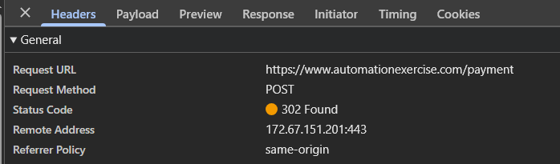
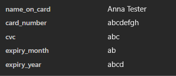
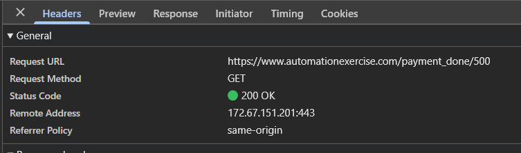
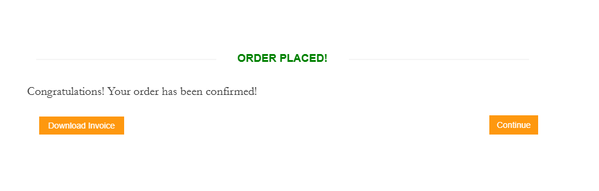

# DevTools Diagnostic Case Study – Payment Validation

## Objective
The purpose of this investigation was to determine how the application
handles alphabetic characters submitted in payment fields intended for
numeric values.

Related defect: [BUG-002 – Card fields accept alphabetic characters](https://github.com/kchardy/tester-portfolio-automation-exercise/issues/2)

## Environment
- Application: Automation Exercise
- Platform: Web
- Browser: Google Chrome
- Tools: Chrome DevTools – Network and Console
- Test account and fictional payment data were used

## Test data
- Name on Card: Anna Tester
- Card Number: `abcdefgh`
- CVC: `abc`
- Expiration Month: `ab`
- Expiration Year: `abcd`

## Observed user-facing behaviour
The form accepted alphabetic characters in every payment field. After
selecting **Pay and Confirm Order**, the application displayed:

> Order placed! Congratulations! Your order has been confirmed!

No validation message was displayed.

## Network analysis
The browser submitted the payment form using the following request:

- Request URL: `https://www.automationexercise.com/payment`
- Request method: `POST`
- Status code: `302 Found`
- Redirect location: `/payment_done/500`
- Payload format: form data

The payload contained alphabetic values in the card number, CVC and
expiration date fields.

The browser subsequently followed the redirect:

- Request URL: `https://www.automationexercise.com/payment_done/500`
- Request method: `GET`
- Status code: `200 OK`

The `302` response is not an application error. It redirects the browser
to the order confirmation page. The complete request chain shows that the
application did not reject the invalid payment data.

## Console analysis
The Console displayed a Mixed Content warning because the HTTPS page
requested a Google Fonts stylesheet over HTTP.

This warning is unrelated to payment validation. It concerns loading a
visual resource and does not explain why the invalid payment data was
accepted.

## Problem localisation
| Layer | Evidence | Assessment |
|---|---|---|
| Frontend | The fields accepted letters and the form allowed submission. | Client-side validation is missing or insufficient. |
| Backend | The server accepted the POST request and redirected the browser to the successful order confirmation page. | Server-side application validation did not reject the invalid values. |
| Database | No database access was available during testing. | Database state was not verified. |

The observable evidence indicates insufficient validation in both the
client interface and server-side application flow. The exact root cause
cannot be confirmed without access to application code and server logs.

## Risk
Invalid payment information can be treated as valid, and the user receives
confirmation that the order was placed. In a production system, payment
data must be validated independently on the server even when client-side
validation is present.

## Evidence
### Payment request

### Submitted form data

### Redirected request

### User-facing result

## Recommended actions
1. Add client-side format validation for all payment fields.
2. Validate the values independently on the server.
3. Reject invalid requests without creating or confirming an order.
4. Return clear validation messages for each incorrect field.
5. Add negative regression tests for non-numeric, empty and incorrectly
   sized values.
